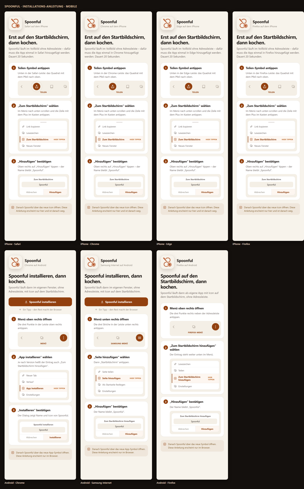
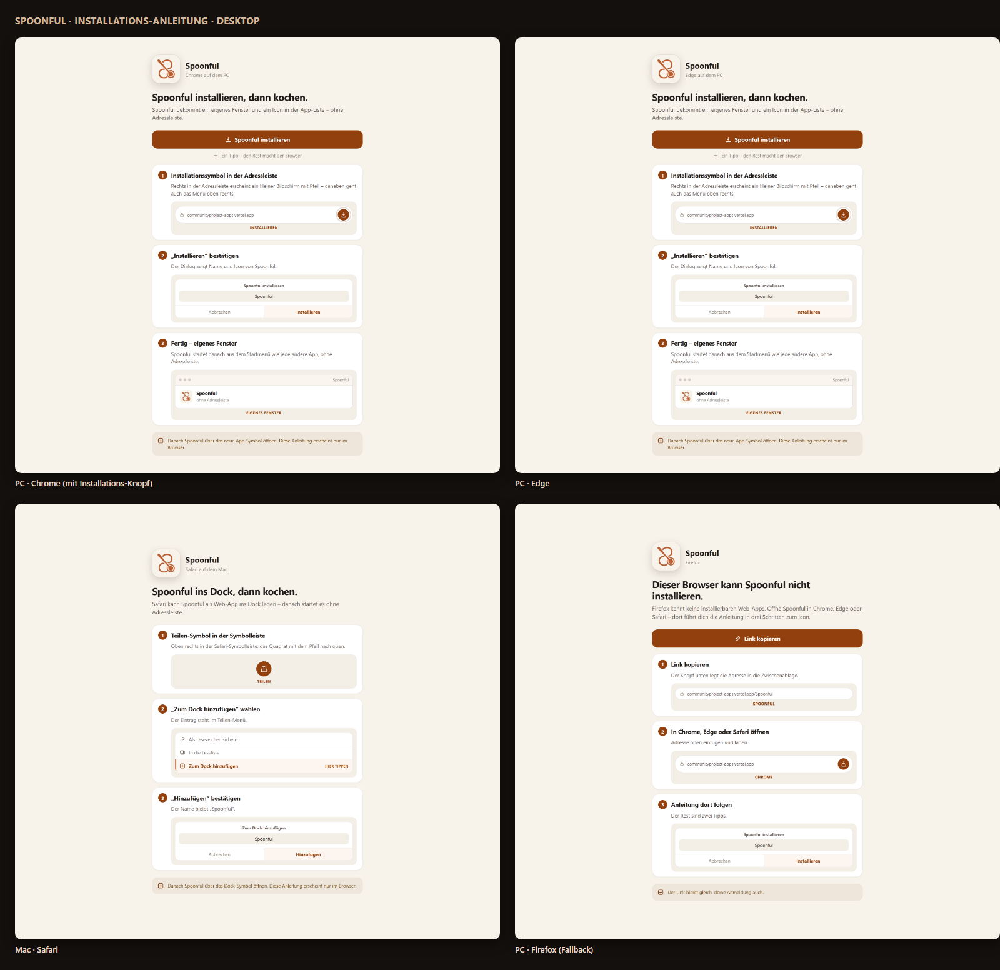

# Spoonful Web-App (`webapp/`) — Regeln und Unterschiede

Gültig ab 3.6.1. Diese Datei ist verbindlich für jede Änderung, die zuerst in
der Web-App gemacht und danach in die React-Native-App übernommen wird.

## 1. Grundprinzip

`webapp/` ist **keine zweite App**. Sie lädt direkt `mobile/App.tsx` und
`mobile/src/**` und rendert denselben Code über `react-native-web` im Browser.

```
mobile/App.tsx ─┐
mobile/src/**  ─┴─> webapp (Vite + react-native-web) ─> Browser
                └─> Android (Gradle) ─> APK
```

Deshalb gilt:

* Screens, Komponenten, Styles, Themes, Texte und Supabase-Logik existieren
  **einmal** in `mobile/src`. Es gibt keine Kopie und keine Parallelversion.
* Eine Änderung, die in `mobile/src` gemacht wird, ist automatisch in beiden
  Apps. Die Web-App zeigt sie nach dem Neuladen, die APK nach dem Build.
* Web-spezifischer Code lebt **ausschließlich** in `webapp/src/shims/` und
  `webapp/src/web/`. Nie in `mobile/`.
* Kein `Platform.OS === 'web'`-Code in `mobile/` — die Web-Schicht wird über
  Aliase in `webapp/vite.config.ts` eingesetzt.
* Keine Funktionen „nur für Web" in `mobile/` einbauen.

## 2. Die einzigen erlaubten Unterschiede (fest, nicht portierbar)

Alles andere muss identisch sein. Diese Punkte **müssen** abweichen, weil der
Browser die native Schnittstelle nicht hat; sie sind keine Feature-Unterschiede:

| Bereich | App (Android) | Web-App | Grund |
| --- | --- | --- | --- |
| Fenster / Layout | fester Handy-Bildschirm | Browserfenster, passt sich an die Fenstergröße an (PC-Ansicht) | kein Gerätebildschirm |
| Tab-Leiste | 8 Tabs, horizontales Wischen | 8 Tabs, Mausrad / Ziehen / Pfeiltasten scrollen (siehe §3) | breites Fenster, Maus statt Finger |
| Speicher | AsyncStorage | `localStorage` (`shims/async-storage.ts`) | kein nativer Speicher |
| Benachrichtigungen | Notifee, geplante OS-Notifications | Web Notifications, Erinnerungen als Timer — **nur solange der Tab offen ist** | Browser kann keine OS-Timer planen |
| Kamera / Galerie | `react-native-image-picker` | `<input type="file">`, `capture`, Canvas-Resize, Base64 | Browser-Picker; Kamera nur über `https`/`localhost` |
| Barcode / QR | Android-WebView mit `file:///android_asset/zxing.min.js` | `<iframe>` + `public/vendor/zxing.min.js`, `postMessage`-Brücke | kein Android-WebView |
| Vorlesen (Kochmodus) | Android-TTS (`NativeModules.SpoonfulTts`) | `speechSynthesis` über denselben NativeModules-Namen | Browser-TTS |
| SVG | `react-native-svg` | DOM-SVG (`shims/svg.tsx`) | kein nativer Renderer |
| Safe Area | native Insets | `env(safe-area-inset-*)` | Browser-Notch |
| Icons | `lucide-react-native` | `lucide-react` (gleiche Icons/Props) | SVG-Renderer |
| Auth-Deeplinks | `spoonful://auth/callback` | `https://<origin>/` | Browser kann kein Custom-Scheme |
| Installation | APK / Play Store | URL, kein APK-Build; Installation über die Browser-Anleitung (§3b) | Web |
| Offline-Start | App-Shell startet offline | Shell braucht beim Laden Netz (Daten danach wie in der App gecacht) | kein Service Worker |

**Nicht** erlaubt sind Unterschiede bei: Funktionen, Texten, Farben, Themes,
Animationen, Rezeptlogik, KI, Tracker, Community, Haushalt, Einkauf, Rechtstexten.

## 3. PC-Verhalten (nur Web-App)

Die acht Tabs sind zusammen breiter als jedes Fenster (`itemW = max(70, Breite/5)`,
also 1,6 × Fensterbreite). Auf dem PC wird die Leiste deshalb bedienbar gemacht
(`webapp/src/web/glue.ts → enhanceTabBar()`):

* **Mausrad** über der Tab-Leiste scrollt horizontal (kein Shift nötig).
* **Ziehen** mit gedrückter linker Maustaste scrollt die Leiste; ein Klick nach
  dem Ziehen wird geschluckt, damit nicht versehentlich ein Tab geöffnet wird.
* **Pfeiltasten** links/rechts scrollen, wenn die Leiste den Fokus hat.
* Die Scrollbar ist sichtbar (8 px), `overscroll-behavior-x: contain` verhindert
  versehentliche Seitennavigation.
* Langes Drücken (Barcode-Scanner am Tracker-Tab) funktioniert mit gedrückter
  Maustaste.

Ansonsten bleibt das Layout responsiv wie in der App (`useWindowDimensions`),
ohne feste Handybreite und ohne zweiten Layout-Code.

## 3b. Installations-Anleitung (nur Web-App)

Spoonful läuft nur installiert (Standalone, ohne Adressleiste) so wie in der App.
Jeder Browser versteckt das hinter einem anderen Menü, deshalb zeigt die Seite
beim Öffnen eine Vollbild-Anleitung **pro Browser-Familie**
(`webapp/src/web/install-prompt.ts`):

| Browser | Schritte |
| --- | --- |
| iOS Safari | Teilen (unten, iPad oben) → „Zum Startbildschirm“ → „Hinzufügen“ |
| iOS Chrome / Edge / Firefox | Teilen in der jeweiligen Leiste → „Zum Startbildschirm“ → „Hinzufügen“ |
| Android Chrome / Edge / Opera | Menü ⋮ → „App installieren“ → „Installieren“ |
| Android Samsung Internet | Menü ☰ → „Seite hinzufügen“ → „Startbildschirm“ |
| Android Firefox | Menü ⋮ → „Zum Startbildschirm hinzufügen“ |
| Desktop Chrome / Edge | Installationssymbol in der Adressleiste → „Installieren“ → eigenes Fenster |
| Desktop Safari | Teilen → „Zum Dock hinzufügen“ |
| Browser ohne Web-App-Installation (z. B. Firefox am PC) | „Link kopieren“ + Hinweis auf Chrome/Edge/Safari |

Regeln:

* erscheint **vor** dem ersten App-Paint (Import in `src/web/install.ts`, vor
  `createRoot`) – die App ist nie ohne Anleitung zu sehen,
* nur außerhalb von `display-mode: standalone` (bzw. `navigator.standalone`),
* **kein** Überspringen: die Anleitung bleibt, bis Spoonful installiert gestartet
  wird; nach `appinstalled` verschwindet sie sofort ohne Neuladen,
* wo der Browser `beforeinstallprompt` liefert (Android-Chromium, Desktop-Chrome/
  Edge), steht über den Schritten ein echter Knopf „Spoonful installieren“, der
  den Browser-Dialog auslöst,
* In-App-Browser (Instagram, WhatsApp, Mail …) können nicht installieren → dort
  „Link kopieren“ und der Hinweis, die Seite im Browser zu öffnen,
* Mocks der Leisten/Menüs sind nachgebaut, keine Screenshots – dadurch bleiben
  sie bei iOS-/Browser-Updates lesbar.





## 4. Arbeitsablauf (Web zuerst, dann APK)

1. Änderung in `mobile/src/...` bzw. `mobile/App.tsx` umsetzen (das ist die
   einzige Quelle), Web-Spezifisches nur in `webapp/src/shims|web`.
2. `cd webapp && npm run dev` → Flow im Browser durchspielen.
3. `cd webapp && npm run build` muss grün sein.
4. Prüfliste aus §7 abarbeiten.
5. Erst wenn es in der Web-App passt: APK bauen
   (`INSTRUCTIONS/BUILD_INSTRUCTIONS.md`, `_build_arm.bat`) — `mobile/` ist
   bereits aktuell, es muss nichts „nachgezogen" werden.
6. Texte immer über `t('…')` / die Wörterbücher, niemals hart im Screen
   (`INSTRUCTIONS/LANGUAGE_INSTRUCTIONS.md`).

## 5. Abhängigkeiten und Build

`webapp/package.json` ist eigenständig: React, React DOM, `react-native-web`,
`@react-navigation/native|bottom-tabs|native-stack`, `react-native-screens`,
`@supabase/supabase-js`, `lucide-react`; `@zxing/library` als devDependency für
das Vendor-Bundle.

* `.npmrc` setzt `legacy-peer-deps=true`, weil `@react-navigation/*` und
  `react-native-screens` `react-native` als Peer deklarieren. Das native Paket
  wird bewusst **nicht** installiert — Vite aliast `react-native` auf
  `react-native-web`.
* `scripts/sync-vendor.mjs` kopiert vor `dev`/`build` das ZXing-UMD-Bundle und
  das Logo nach `public/`.
* Getestet: `npm install && npm run build` in `webapp/` läuft **ohne**
  `mobile/node_modules` (nur der Quellcode aus `mobile/` wird gebraucht).

```bash
cd webapp
npm install
npm run dev      # http://127.0.0.1:5178
npm run build    # dist/
npm run preview  # gebauten Stand prüfen
```

## 6. Supabase / Auth

Die Web-App nutzt dasselbe Projekt und dieselben Keys wie die App
(`mobile/src/config-secrets.ts`).

* `webapp/src/web/glue.ts` ersetzt `spoonful://auth/callback` durch
  `<origin>/` und `spoonful://reset` durch `<origin>/?type=recovery`.
* Damit Bestätigungs-, Magic-Link-, Reset- und Google-Mails zurückführen, muss
  die Adresse in Supabase unter *Authentication → URL Configuration →
  Redirect URLs* stehen:
  `http://127.0.0.1:5178/` (lokal) und später `https://<domain>/`.
* Abweichende Ziele: `VITE_AUTH_REDIRECT_URL`, `VITE_RESET_REDIRECT_URL`.
* Getestet am 20.11.2026: E-Mail-Bestätigung (Redirect + Session in der Web-App)
  und Google-Login (Supabase → `accounts.google.com`, `redirect_to` = Web-Origin).
  Der letzte Google-Schritt braucht ein echtes Google-Konto.

## 7. Prüfliste vor „fertig"

* `npm run build` grün.
* Login, Logout, Bibliothek (Rezepte laden), Rezeptdetail, Kochmodus.
* Einkauf (Artikel anlegen/abhaken), Tracker, Community, Haushalt, Design,
  Einstellungen, Rechtstexte.
* Barcode: Langdruck auf Tracker → Kamera/iframe; QR: Haushalt → QR-Code.
* Konsole ohne neue Fehler. Erwartet und harmlos: einzelne 401/404 der
  Admin-/Update-Gates für normale Nutzer (auch in der App so).

## 8. Bekannte Grenzen

* Benachrichtigungen nur bei geöffnetem Tab (Browser-Limit).
* Google-Login und Bestätigungsmails lassen sich nur mit einem echten Konto
  vollständig durchklicken; der Redirect-Weg ist geprüft.
* Kein Service Worker: Die App-Shell braucht beim ersten Laden Netz.
* Screenshots/visueller Pixel-Vergleich ist in dieser Umgebung nicht verfügbar;
  geprüft werden Struktur, Inhalte und Zustände im DOM.
